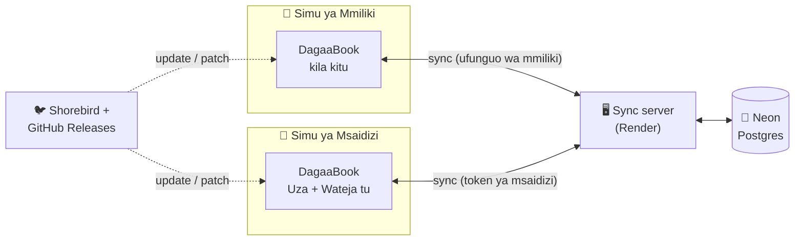

<div align="center">


# DagaaBook

**Daftari la kidijitali la biashara ya dagaa.**
Mizigo, mauzo, wateja na madeni yote mahali pamoja, likifanya kazi hata bila mtandao.

[](https://github.com/FranceHK/dagaabook/actions/workflows/build-apk.yml)
[](https://github.com/FranceHK/dagaabook/releases/latest)
[](https://flutter.dev)
[](https://shorebird.dev)


[**⬇️ Pakua APK**](https://github.com/FranceHK/dagaabook/releases/latest) · [Vipengele](#-vipengele) · [Jinsi inavyofanya kazi](#️-jinsi-inavyofanya-kazi) · [Kuweka server](#️-kuweka-server-ya-backup) · [English](#-in-english)

</div>

---

## 📖 Kuhusu

DagaaBook ni app ya Android kwa mfanyabiashara wa dagaa anayenunua **mabox** kwa jumla na kuyauza kwa wateja. Kazi yake ni kuchukua nafasi ya daftari la karatasi. Inaonyesha kila wakati:

- mzigo upi umebaki stoo, na faida ya kila box;
- nani amenunua nini, siku gani, na kwa malipo gani;
- nani anadaiwa kiasi gani, na tangu lini;
- mauzo na faida ya leo, wiki, mwezi au muda wote.

App imejengwa kwa ajili ya **mmiliki mmoja** na **wasaidizi wake**. Data inakaa kwenye simu, kwa hiyo inafanya kazi bila mtandao. Ukiwa mtandaoni, inahifadhiwa na kuunganishwa kwenye database yako binafsi.

---

## ✨ Vipengele

<table>
<tr>
<td width="50%" valign="top">

### 📦 Mizigo (Stoo)
- Ongeza mzigo kwa idadi ya mabox, bei ya kununua na bei ya kuuza
- **Faida inayotarajiwa** inaonyeshwa papo hapo unapojaza fomu
- Faida kwa kila box, faida uliyokwisha pata, na faida iliyobaki
- Mizigo ya hivi karibuni na iliyopo stoo inaonekana kwenye dashboard

</td>
<td width="50%" valign="top">

### 💰 Mauzo
- Uza kutoka mzigo maalum, ili stoo ipungue yenyewe
- Malipo ya **cash, simu, mkopo** au **kalipa kidogo**
- Malipo ya simu yanahitaji **namba ya muamala** (M-Pesa, Tigo Pesa…), na namba haiwezi kutumika mara mbili
- Kila uuzaji unaonyesha aliyeuza: wewe au msaidizi

</td>
</tr>
<tr>
<td valign="top">

### 👥 Wateja na Madeni
- Taarifa kamili ya kila mteja: alichonunua **kila siku**, malipo, na deni lililobaki mwisho wa kila siku
- Deni la zamani zaidi ambalo halijalipwa na lina siku ngapi
- Rekodi malipo ya deni kwa cash au simu
- Hariri jina na namba ya mteja (mauzo yake ya zamani yanasasishwa pia)

</td>
<td valign="top">

### 📊 Ripoti
- Leo, wiki hii, mwezi huu, au muda wote
- Mapato, faida, madeni, na malipo yaliyopokelewa
- Grafu ya mapato na faida
- Faida kwa aina ya dagaa, wateja wakubwa, wadaiwa wakubwa, na miamala ya simu

</td>
</tr>
<tr>
<td valign="top">

### 🧑‍🤝‍🧑 Wasaidizi
- Mmiliki anamtengenezea msaidizi akaunti (jina, namba, nywila)
- Msaidizi anatumia **simu yake mwenyewe**
- Anaweza **kuuza kwa cash tu** kwa bei uliyoweka, kuona wateja, na kusajili wateja wapya
- **Hawezi** kuhariri, kuona faida, madeni, ripoti wala bei ya kununua. Hili linazuiwa pia na server, si app tu.
- Unaweza kumsimamisha au kumbadilishia nywila wakati wowote

</td>
<td valign="top">

### ☁️ Backup na Update
- Inafanya kazi **offline**, na sync inafanyika yenyewe mtandao ukirudi
- Data ya simu ya mmiliki na ya msaidizi inaunganishwa bila kufuta chochote
- Backup inaenda kwenye database yako ya **Neon Postgres** kupitia server ndogo
- **Update zinaingia moja kwa moja** kwenye app kupitia Shorebird, bila kupakua APK mpya

</td>
</tr>
</table>

**Pia:** muonekano maalum wa tablet (menyu ya pembeni) na simu (kitufe cha katikati kilichoinuka), Kiswahili na Kiingereza, na kuhariri jina na namba ya mmiliki.

---

## ⚙️ Jinsi inavyofanya kazi



- **Simu kwanza.** Kila kitu kinahifadhiwa kwenye simu, kwa hiyo app inafanya kazi hata bila mtandao.
- **Sync.** Ikipata mtandao, app inatuma mabadiliko na kupokea yaliyofanywa kwenye simu nyingine. Rekodi haziwahi kufutwa, kwa hiyo data ya simu mbili inaunganishwa kwa `id`. Idadi ya mabox yaliyouzwa inahesabiwa upya kutoka kwenye mauzo ya simu zote.
- **Usalama.** Link ya database haiko ndani ya app wala kwenye code. Iko kwenye server tu. App inatumia ufunguo wa sync (mmiliki) au token ya msaidizi, na server ndiyo inayoamua kila mmoja anaruhusiwa nini.

---

## 📲 Kusakinisha

1. Pakua `dagaabook-vX.Y.Z.apk` kutoka [**Releases**](https://github.com/FranceHK/dagaabook/releases/latest).
2. Ifungue kwenye simu, kisha ruhusu "kusakinisha kutoka chanzo hiki" ukiulizwa.
3. **Mmiliki:** ingia kwa namba na nywila ya mmiliki, kisha uzibadilishe mara moja kwenye *Wasifu → Badili Namba / Nywila*.
4. **Msaidizi:** bonyeza *"Wewe ni msaidizi? Ingia hapa"*, kisha weka anwani ya server, namba yake na nywila aliyopewa na mmiliki.

> [!TIP]
> Baada ya kusakinisha mara ya kwanza, huhitaji kupakua tena. Update ndogo zinaingia zenyewe kupitia Shorebird. Update kubwa (za native) zinaonyesha ujumbe **"Kuna Update Mpya – Pakua"** ndani ya app.

---

## 🛠️ Kuweka server ya backup

Server iko kwenye folda [`server/`](server/). Ni app ndogo ya Dart (shelf + postgres) inayoendeshwa kwa Docker.

1. Tengeneza database bure kwenye [Neon](https://neon.tech) na unakili connection string yake.
2. Kwenye [Render](https://render.com): **New → Blueprint**, kisha chagua repo hii. Itasoma [`render.yaml`](render.yaml).
3. Render itakuuliza vitu viwili:

   | Variable | Thamani |
   |---|---|
   | `DATABASE_URL` | connection string ya Neon (`postgresql://…?sslmode=require`) |
   | `SYNC_KEY` | neno la siri unalobuni, angalau herufi 12 |

4. Kwenye app: *Wasifu → ⚙️ Mipangilio → Hifadhi Mtandaoni → Unganisha Server*. Weka anwani ya Render na `SYNC_KEY`, kisha bonyeza **Sync Sasa**.

> [!IMPORTANT]
> Usiweke `DATABASE_URL` wala `SYNC_KEY` kwenye code au kwenye issue/PR. Ziweke kwenye Render tu.

<details>
<summary>API ya server</summary>

| Njia | Ruhusa | Kazi |
|---|---|---|
| `GET /health` | wazi | Kuangalia kama server iko hai |
| `POST /helper/login` | wazi | Msaidizi anaingia kwa namba + nywila, na anapewa token |
| `POST /sync` | mmiliki / msaidizi | Kutuma rekodi na kupokea zilizounganishwa |
| `GET /snapshot` | mmiliki / msaidizi | Kupakua data (msaidizi hapati malipo, wasaidizi wala bei ya kununua) |

Mmiliki anatumia `Authorization: Bearer <SYNC_KEY>`, na msaidizi anatumia `Bearer helper.<id>.<token>`.
Msaidizi anaweza **kuongeza tu**: mauzo ya cash kwa bei sahihi, na wateja wapya.

</details>

---

## 🚀 Kutoa update

| Unataka nini | Fanya hivi | Mtumiaji anafanya nini |
|---|---|---|
| Mabadiliko ya kawaida (skrini, maandishi, hesabu) | GitHub → **Actions → Shorebird Patch → Run workflow** | Hafanyi chochote. Inaingia app ikifunguliwa tena. |
| Mabadiliko ya native (package mpya, ruhusa, icon) | `git tag v1.3.0` kisha `git push origin v1.3.0` | Anabonyeza **Pakua** kwenye ujumbe wa update |

Kila tag `v*` inajengwa na [GitHub Actions](.github/workflows/build-apk.yml). APK inasainiwa kwa key ya kudumu iliyoko kwenye GitHub Secrets, kwa hiyo update inaingia juu ya app ya zamani **bila kufuta data**.

---

## 👩‍💻 Kwa developer

```bash
flutter pub get
flutter run            # simu, emulator au Chrome
flutter test           # majaribio ya app
cd server && dart test # majaribio ya server
```

<details>
<summary>Muundo wa code</summary>

```
lib/
├── core/        # rangi, maandishi (sw/en), responsive, hesabu za madeni, version
├── models/      # Customer, Sale, Payment, StockItem, Helper, BusinessProfile
├── providers/   # hali ya app (auth, mizigo, mauzo, wateja, wasaidizi, sync)
├── services/    # LocalStore (data ya simu), SyncService, UpdateService
├── screens/     # dashboard, mizigo, mauzo, wateja, madeni, ripoti, helper, settings
└── widgets/     # vipande vinavyotumika sehemu nyingi
server/          # sync server (Dart + Postgres)
.github/         # build ya APK, release na patch za Shorebird
```

</details>

**Teknolojia:** Flutter · Provider · shared_preferences · fl_chart · Dart shelf · PostgreSQL (Neon) · Docker (Render) · Shorebird · GitHub Actions

---

## 🌍 In English

**DagaaBook** is an offline-first Android app (phone and tablet) for a small wholesale *dagaa* (dried sardine) business. It tracks:
- stock in boxes, with profit per box;
- sales paid by cash, mobile money (with transaction IDs), credit or part payment;
- customer debts, day by day;
- full reports.

The owner can add **helpers** who log in on their own phones and may only see customers, add customers and make cash sales at the owner's price. The sync server enforces these limits too, not just the app. Data syncs through a small Dart server on Render into Neon Postgres. Code updates reach installed apps over the air with Shorebird.

<div align="center">

---

Imetengenezwa kwa ❤️ Mwanza, Tanzania · [FranceHK](https://github.com/FranceHK)

</div>
